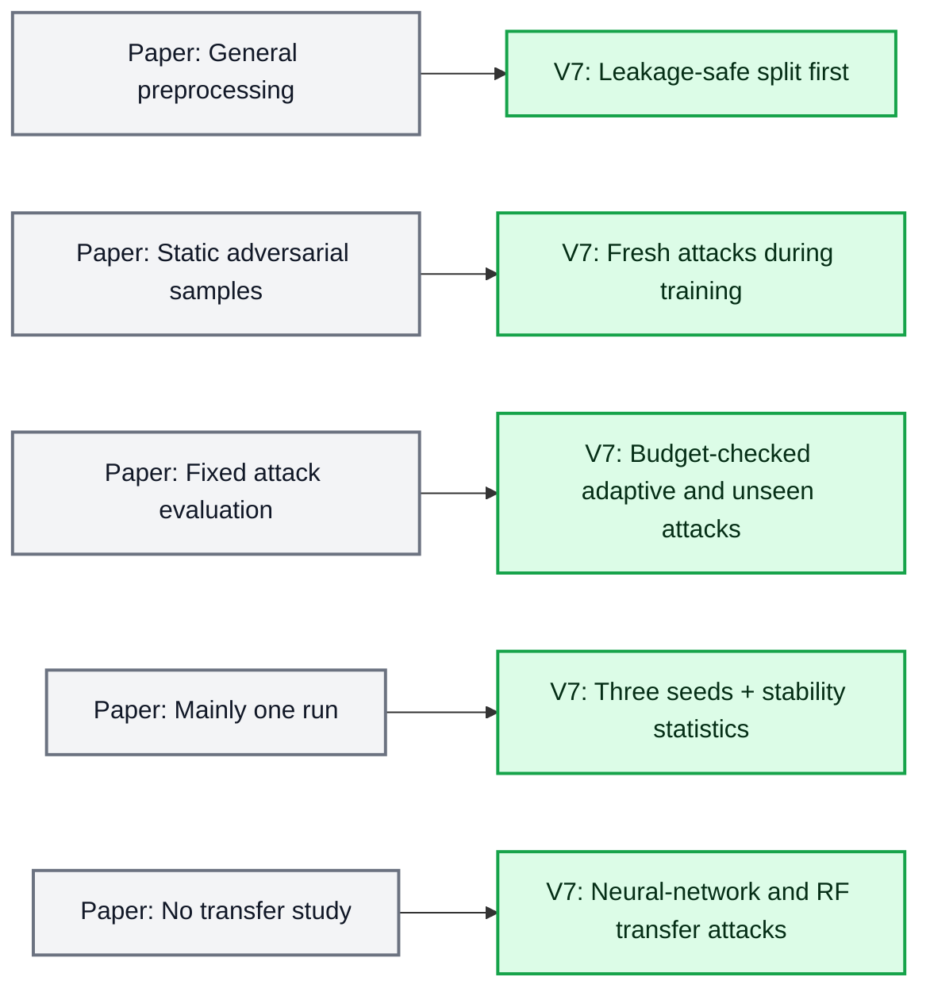
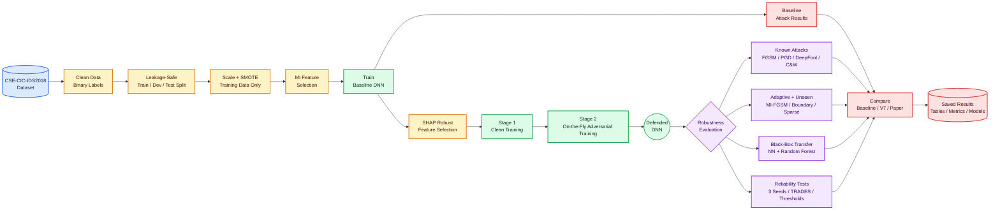
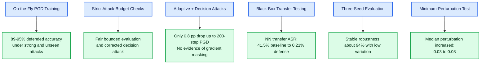

# V7 Pipeline Workflow

## 1. Original paper vs V7

```mermaid
flowchart LR
    subgraph PAPER["ORIGINAL PAPER PIPELINE"]
        direction TB
        P1[("CSE-CIC-IDS2018")] --> P2["Preprocessing"]
        P2 --> P3["MI / Variance<br/>Feature Selection"]
        P3 --> P4["SMOTE<br/>Class Balancing"]
        P4 --> P5["Train Baseline DNN"]
        P5 --> P6["Generate Static<br/>FGSM + PGD + DeepFool Samples"]
        P6 --> P7["SHAP Robust<br/>Feature Selection"]
        P7 --> P8["Adversarial Training"]
        P8 --> P9["Evaluate Fixed Attacks<br/>+ Square Attack"]
        P9 --> P10[("Reported Defense<br/>Accuracy: 88%")]
    end

    subgraph V7["V7 EXTENDED PIPELINE"]
        direction TB
        V1[("CSE-CIC-IDS2018")] --> V2["Leakage-Safe<br/>Train / Dev / Test Split"]
        V2 --> V3["Scale + SMOTE<br/>Training Data Only"]
        V3 --> V4["MI Selection<br/>Threshold + Elbow Analysis"]
        V4 --> V5["Train Baseline DNN"]
        V5 --> V6["SHAP Selection<br/>Development Data Only"]
        V6 --> V7A["Stage 1<br/>Clean Robust-Feature Training"]
        V7A --> V8["Stage 2<br/>On-the-Fly PGD + Gradient-Free Training"]
        V8 --> V9["Budget-Verified Evaluation<br/>Known + Adaptive + Unseen Attacks"]
        V9 --> V10["Transfer + Multi-Seed<br/>TRADES + Minimum Perturbation"]
        V10 --> V11[("Mean Defended Accuracy<br/>FGSM / PGD / DeepFool: 92.62%")]
    end

    P2 -. "Safer separation" .-> V2
    P6 -. "Dynamic attacks" .-> V8
    P9 -. "Stronger evaluation" .-> V9

    classDef paper fill:#f3f4f6,stroke:#6b7280,color:#111827,stroke-width:2px;
    classDef v7 fill:#dcfce7,stroke:#16a34a,color:#052e16,stroke-width:2px;
    classDef outcome fill:#dbeafe,stroke:#2563eb,color:#172554,stroke-width:3px;
    class P1,P2,P3,P4,P5,P6,P7,P8,P9 paper;
    class V1,V2,V3,V4,V5,V6,V7A,V8,V9,V10 v7;
    class P10,V11 outcome;
```

### Main differences at a glance

## 2. Detailed V7 experimental pipeline

## 3. What V7 changed and what we found

> **Summary:** V7 combines MI-SHAP feature selection with on-the-fly adversarial training, then validates the defense using bounded, adaptive, unseen, transfer-based, and multi-seed experiments.

---

# Full V7 Pipeline Explained in Easy Terms

Think of V7 as training and testing a security guard. The guard looks at network-traffic records and decides whether the traffic is **normal (0)** or a **cyberattack (1)**.

## Part 1: Prepare the data

### 1. Load the network-traffic dataset

We use the **CSE-CIC-IDS2018** dataset. It contains examples of normal network traffic and different cyberattacks.

**Why we use it:** The model needs real examples to learn the difference between safe and malicious traffic.

### 2. Clean the data

We remove or repair missing values, infinite values, duplicates, unusable columns and text values that the model cannot directly understand.

**Why we do it:** Bad data can confuse the model, produce incorrect results or cause the code to fail.

### 3. Convert the labels into two classes

All normal records become `0`, and all attack records become `1`.

**Why we do it:** Our task is binary intrusion detection: decide whether each record is normal or an attack.

### 4. Create training, development and test sets

The data is separated into three parts:

- **Training set:** teaches the model.
- **Development set:** helps select features and settings.
- **Test set:** provides the final unbiased result.

**Why we do it:** The model must not see the final test questions while studying. Otherwise, the result may look better than it really is. This problem is called **data leakage**.

## Part 2: Prepare useful features

### 5. Select features using Mutual Information

A feature is one piece of network information, such as packet size, connection duration or number of packets. **Mutual Information (MI)** measures how useful each feature is for distinguishing attacks from normal traffic.

**Why we use it:** It removes weak and unnecessary features, reduces noise and training time, and helps the model focus on useful information.

### 6. Scale the features

Different features may have very different numerical ranges. Scaling converts them into similar ranges.

**Why we do it:** Without scaling, features containing large numbers may unfairly dominate the neural network and adversarial-attack calculations.

### 7. Balance the training data with SMOTE

**SMOTE** means **Synthetic Minority Over-sampling Technique**. If the training data contains many normal records but fewer attack records, SMOTE creates additional synthetic minority-class examples from existing samples.

**Why we use it:** Otherwise, the model may learn to predict the majority class most of the time. SMOTE is applied only to the training data so the final test remains fair.

## Part 3: Build and attack the baseline model

### 8. Train the normal DNN

A **DNN (Deep Neural Network)** learns patterns from the selected network features. The first model is called the **baseline model** because it is trained normally without the V7 defense.

**Why we use it:** We need an unprotected model to demonstrate the system's vulnerability before applying the defense.

### 9. Test the baseline normally

We measure accuracy, precision, recall and F1 score.

- **Accuracy:** percentage of all predictions that are correct.
- **Precision:** how often an attack prediction is correct.
- **Recall:** how many real attacks are detected.
- **F1 score:** balance between precision and recall.

**Why we do it:** This establishes how well the normal model works before adversarial attacks are introduced.

### 10. Attack the baseline model

We create slightly modified network records designed to fool the model:

- **FGSM:** makes one fast modification using the model's gradient.
- **PGD:** makes several smaller modifications step by step.
- **DeepFool:** searches for a nearby decision boundary.
- **Projected C&W:** optimizes a harmful input while keeping it inside the allowed limit.
- **Square-style random search:** searches for harmful modifications without using gradients.

**Why we do it:** A model may work well on normal data but fail when an attacker deliberately manipulates its inputs.

## Part 4: Select robust features

### 11. Analyse features using SHAP

**SHAP** explains how strongly each feature influences the model's predictions. V7 performs SHAP analysis using development data and combines it with MI information.

**Why we use it:** Some features may improve normal accuracy but be easy to manipulate. MI-SHAP selection attempts to retain features that are useful and dependable.

### 12. Test feature-selection thresholds

V7 checks cumulative feature thresholds such as 70%, 80% and 90%. It also checks an **elbow point**, where adding more features stops giving much extra benefit.

**Why we do it:** It provides evidence for the number of selected features instead of choosing that number without justification.

## Part 5: Train the defended model

### 13. Stage 1: Clean training

A new model is trained normally using the selected robust features.

**Why we do it:** This gives the defended model a good starting point before adversarial training begins.

### 14. Stage 2: On-the-fly adversarial training

During training, V7 creates fresh adversarial examples against the model's current version. Each training batch contains approximately 50% clean samples and 50% adversarial samples. Most adversarial samples use PGD, while some use gradient-free random search.

**Why we use it:** It is similar to training a security guard using both normal situations and simulated attacks. Fresh attacks change as the model changes, making training stronger than relying only on a fixed collection of old attacks.

### 15. Keep modifications inside the attack budget

The attack budget is called **epsilon**, written as `eps`. It specifies the maximum amount an attacker is allowed to modify an input. V7 clips values into valid ranges, projects adversarial examples back into the permitted region and automatically checks the final perturbations.

**Why we do it:** An input changed by an unlimited amount is not a fair adversarial example and may no longer resemble the original sample.

## Part 6: Evaluate the defended model

### 16. Test clean performance

The defended model is tested using normal, unmodified data.

**Why we do it:** A defense is not useful if it becomes robust but can no longer classify ordinary traffic correctly. V7's clean accuracy decreased by approximately **1.19 percentage points**, which is the clean-accuracy cost of the defense.

### 17. Test known attacks

The defended model is evaluated using FGSM, PGD, DeepFool and projected C&W.

**Why we do it:** This allows comparison between the baseline and defended models and, where the settings are comparable, with the original paper.

### 18. Test unseen attacks

V7 adds attacks that were not part of its main training process:

- **MI-FGSM:** uses momentum to create a more stable gradient attack.
- **Sparse attack:** modifies only a limited number of features.
- **Random search:** searches for an adversarial input without gradients.
- **Boundary Search:** uses predictions to search near the model's decision boundary.

**Why we do it:** A real attacker will not necessarily use the same attack used during training. The defense should also work against unfamiliar attacks.

### 19. Test adaptive PGD

V7 runs PGD with multiple random starting points and with 20, 50, 100 and 200 attack steps.

**Why we do it:** This checks whether the defense fails when the attacker receives more time and optimization effort. Increasing PGD from 20 to 200 steps reduced defended accuracy by only about **0.8 percentage points**.

### 20. Check for gradient masking

**Gradient masking** happens when a model makes its gradients difficult to use without becoming genuinely robust. V7 compares gradient-based attacks, such as MI-FGSM, with decision-based attacks, such as Boundary Search.

**Why we do it:** If gradient attacks fail but decision attacks succeed easily, the defense may only be hiding its gradients. V7 obtained similar results for both attack categories, showing no clear evidence of gradient masking.

### 21. Run black-box transfer attacks

V7 trains two substitute or surrogate models: another neural network and a Random Forest. Attacks are created against these substitute models and then transferred to the real target model.

**Why we do it:** This represents a black-box attacker who cannot access the real model but builds an approximate substitute. Neural-network transfer attack success fell from **41.5% against the baseline to 0.21% against the defense**.

### 22. Measure the minimum required perturbation

V7 gradually increases attack strength until the model makes a mistake.

**Why we do it:** This measures how much modification is needed to fool the model instead of checking only one fixed attack strength. The median required perturbation increased from **0.03 for the baseline to 0.08 for the defense**.

### 23. Repeat the experiment with three seeds

V7 repeats training using random seeds 42, 123 and 2024. A seed controls random operations such as model initialization and sample selection.

**Why we do it:** One run could be successful because of luck. Multiple seeds test whether the result is reproducible. Defended accuracy remained around **94% with low variation**.

### 24. Compare with TRADES

**TRADES** is another adversarial-training method designed to balance normal accuracy and adversarial robustness.

**Why we use it:** It tells us whether a more specialized training method is substantially better than V7's PGD-mixed training. TRADES provided only a small improvement, indicating that the simpler V7 method was already effective.

## Part 7: Produce the final results

### 25. Compare all models

V7 compares the original paper, baseline model, defended model, TRADES model, feature-selection settings, attacks and random seeds.

**Why we do it:** This shows what changed, whether the defense helped and whether its improvement remained stable. The paper reported **88% defended accuracy**, while V7 achieved **92.62% mean defended accuracy across FGSM, PGD and DeepFool**. This comparison must be presented carefully because the paper does not provide every attack parameter.

### 26. Save everything

V7 saves trained models, attack configurations, evaluation metrics, perturbation measurements, tables, graphs, multi-seed results, transfer results and runtime information.

**Why we do it:** Saved artifacts make the experiment easier to verify, reproduce and present in the thesis.

## Complete idea in one sentence

> We first train a normal intrusion detector, demonstrate that adversarial inputs can fool it, select more reliable features, retrain it using continuously generated attacks, and then test it with stronger, unfamiliar and black-box attacks to verify that the improvement is genuine.
