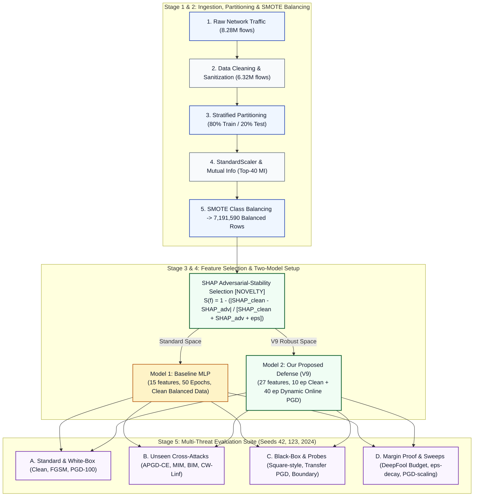

# Thesis Research Briefing: Robust Adversarial Defense for Cloud NIDS (V9)

**Author / Researcher:** Thesis Candidate  
**Benchmark:** CSE-CIC-IDS2018 (6.32M Clean Flows)  
**Evaluation Protocol:** 3-Seed Independent Replication (Seeds 42, 123, 2024)  
**Hardware Platform:** AMD Radeon RX 7600 (8 GB VRAM) via PyTorch + ROCm (`cuda:0`)  
**Primary Setup:** Baseline Model vs. Our Proposed Robust Defense (V9)  
**Primary Deliverables:** `master_result.csv`, `deepfoolbudget.csv`, `v9summary.pdf`

---

## 1. Core Problem Solved & Executive Summary

### The Problem Addressed:
Deep learning-based Network Intrusion Detection Systems (NIDS) deployed in cloud environments suffer from severe vulnerabilities to adversarial evasion attacks. Conventional defenses exhibit three common limitations:
1. **The Accuracy-Robustness Trade-Off:** Traditional adversarial training often degrades clean network traffic detection.
2. **Overfitting to Seen Attacks:** Training against static attacks (e.g., standard FGSM/PGD) frequently fails when adversaries employ unseen perturbation methods or adaptive step sizes.
3. **Apparent vs. True Robustness:** Defenses may rely on gradient masking or brittle representations rather than enforcing wider margin separations between normal and malicious traffic manifolds.

### Our V9 Solution:
We developed **V9 Defense**, combining **Adversarial-Stability SHAP Feature Selection** with a pure-GPU **Dynamic Online PGD Adversarial Training Engine**. 

> **Headline Summary:**  
> Our proposed model (V9) improves clean detection performance and substantially strengthens robustness across multiple bounded white-box, transfer, and gradient-free evaluations compared to the standard Baseline model. Under unconstrained DeepFool, our model requires substantially larger perturbations to reach a misclassification, although unrestricted DeepFool can still eventually cross the decision boundary.

### Executive Performance Highlights:
- **Clean Detection Performance:** **96.19% ± 0.03%** accuracy (F1: 0.9620), improving upon the Baseline (92.82%) by **+3.37%**. Our model improved clean accuracy while simultaneously improving adversarial robustness under the evaluated threat model.
- **Bounded White-Box Robustness (PGD-100, $\epsilon=0.05$):** Achieved **90.13% ± 1.20%** accuracy and **6.05% ± 1.01% ASR** (a **70.0% relative ASR reduction** vs. Baseline at 20.14%).
- **Extended Cross-Attack Robustness:** Reduced Attack Success Rates by **53.5% to 73.8%** across Auto-PGD (APGD-CE), MIM (MI-FGSM), BIM (I-FGSM), CW-$L_\infty$ Margin, Square-style, and Transfer attacks.
- **DeepFool Empirical Perturbation Distance:** Unconstrained DeepFool required a **2.03× larger mean $L_2$ perturbation** ($4.1502$ vs. $2.0395$) to find an adversarial misclassification against our model compared to the Baseline.

---

## 2. Experimental Pipeline, Feature Selection & Training Configuration

### A. Feature Selection Breakdown
- **Candidate Pool:** Mutual Information (MI) filtering retained the top **40 candidate features** from the cleaned dataset.
- **Standard Feature Space (15 Features):** Standard baseline features.
- **V9 Robust Feature Space (27 Features):** Selected using the clean/adversarial stability scoring function:
  $$S(f) = 1 - \frac{|\text{SHAP}_{\text{clean}}(f) - \text{SHAP}_{\text{adv}}(f)|}{\text{SHAP}_{\text{clean}}(f) + \text{SHAP}_{\text{adv}}(f) + \epsilon}$$
  retaining the subset of features that collectively account for 80% of cumulative adversarial stability weight.

### B. Exact Dataset Dimensions & Training Configuration Table

| Configuration Parameter | Dataset & Timing Specification | Methodological Purpose & Rationale |
| :--- | :--- | :--- |
| **Dataset Partitioning** | Raw Clean: 6,320,003 flows Train: 4,550,401 \| Dev: 505,601 Test: 1,264,001 (Strict Isolation) | Industry-standard cloud network flow benchmark; strict train/test isolation, zero feature/SMOTE leakage |
| **Data Rows after SMOTE** | **7,191,590 Balanced Rows** (Applied strictly on Core-Train) | Resolves extreme class imbalance across 14 intrusion classes on training pool only |
| **Feature Selection Counts** | 40 Candidate (MI) &rarr; 15 Standard Space \| **27 V9 Space** | Selected using SHAP clean/adversarial stability S(f); retains 80% cumulative stability weight |
| **Training Schedule & Time** | Phase 1: 10 ep Clean Pretraining Phase 2: 40 ep Online PGD (5 steps) **Training Time: ~69 min / seed** | Pure-GPU dynamic online batch perturbation generation on AMD RX 7600 (Batch Size = 2048) |
| **Threat Model & Test Time** | $\epsilon = 0.05$ ($L_\infty$ feature space) **Evaluation Time: ~15 min / seed** Seeds: `[42, 123, 2024]` | Standardized $L_\infty$ feature-space threat model; 11 threat benchmarks evaluated across all 3 seeds |

---

## 3. Master Comparative Results (Mean ± Std Across 3 Seeds)

| Threat Benchmark | Threat Category | Baseline Model (MLP) | Our Proposed Model (V9) | Observed Improvement & Defense Gain |
| :--- | :--- | :---: | :---: | :---: |
| **Clean Network Traffic** | Standard Detection | 92.82% ± 0.07% (F1: 0.9303) | **96.19% ± 0.03%** **(F1: 0.9620)** | **+3.37% Clean Accuracy Gain** Our model improved clean accuracy while strengthening defense |
| **PGD (100 Steps, $\epsilon=0.05$)** | Whitebox Multi-Step | 73.90% ± 2.43% ASR: 20.14% | **90.13% ± 1.20%** **ASR: 6.05%** | **+16.23% Acc under attack** **70.0% relative ASR reduction** vs Baseline |
| **FGSM (Single-Step, $\epsilon=0.05$)** | Whitebox Single-Step | 84.20% ± 3.30% ASR: 8.91% | **92.67% ± 1.56%** **ASR: 3.62%** | **+8.47% Acc under attack** **59.4% relative ASR reduction** vs Baseline |
| **Square-style Attack** | Blackbox Score-Based | 82.00% ± 0.89% ASR: 18.08% | **91.83% ± 1.07%** **ASR: 5.27%** | **+9.83% Acc under attack** **70.9% relative ASR reduction** vs Baseline |
| **Transfer PGD *(Surrogate WiderNet)*** | Blackbox Transfer | 79.23% ± 3.62% ASR: 14.90% | **94.13% ± 1.68%** **ASR: 2.08%** | **+14.90% Acc under attack** **86.0% relative ASR reduction** vs Baseline |
| **Boundary Search Probe** | Decision Diagnostic | 10.17% inside $\epsilon$ (Refine: 100%) | **4.56% inside $\epsilon$** **(Refine: 100%)** | **55.2% fewer boundary transitions** Significantly fewer samples near the decision threshold |

---

## 4. Extended Cross-Attack Robustness Evaluation

| Unseen Attack Variant | Optimization Formulation | Baseline Model ASR | Our Proposed Model (V9) | Observed Performance & Improvement |
| :--- | :--- | :---: | :---: | :---: |
| **Auto-PGD (APGD-CE)** | AutoAttack adaptive step size + momentum halving | 22.78% ± 1.44% (Acc: 71.33%) | **7.70% ± 1.89%** **(Acc: 88.55%)** | **66.2% ASR Reduction (+17.2% Acc)** Resists step-size decay & AutoAttack |
| **MIM (MI-FGSM)** | Momentum-iterative gradient ascent ($\mu=1.0$, 40 steps) | 16.14% ± 2.10% (Acc: 77.43%) | **5.09% ± 1.77%** **(Acc: 91.05%)** | **68.5% ASR Reduction (+13.6% Acc)** Resists velocity-driven gradient directions |
| **BIM (I-FGSM)** | Clean-start basic iterative gradient ascent (40 steps) | 18.15% ± 2.81% (Acc: 75.60%) | **4.76% ± 0.25%** **(Acc: 91.37%)** | **73.8% ASR Reduction (+15.8% Acc)** Strong resistance to clean-start iterative updates |
| **CW-$L_\infty$ Margin Attack** | Carlini-Wagner logit max-margin loss ($Z_{\text{other}} - Z_{\text{true}}$) | 20.05% ± 2.09% (Acc: 73.98%) | **6.03% ± 1.02%** **(Acc: 90.15%)** | **69.9% ASR Reduction (+16.2% Acc)** Overcomes margin loss optimization |

---

## 5. DeepFool Perturbation Budget Analysis

| DeepFool Metric | Baseline Model | Our Proposed Model (V9) | Observed Perturbation Magnitude & Interpretation |
| :--- | :---: | :---: | :--- |
| **Unconstrained Flip Rate** | 74.98% | 94.03% | Unbounded search iterates until a boundary crossing is found |
| **Mean $L_2$ Distance to Flip** | 2.0395 | **4.1502** | **DeepFool required a 2.03× larger mean $L_2$ perturbation** to find misclassifications |
| **Mean $L_\infty$ Needed to Flip** | 1.1835 | **2.3238** | Average distortion was 46.5× larger than the nominal $\epsilon=0.05$ budget |
| **Median $L_\infty$ Distortion** | 0.6141 | **1.0064** | Approximately 1.64× higher median distortion than the Baseline |
| **Flips Exceeding $\epsilon=0.05$** | 94.42% | **97.33%** | **97.33% of successful DeepFool flips required $L_\infty > 0.05$** |
| **Valid Within-$\epsilon$ ($\le 0.05$) ASR** | 5.58% | **2.67%** | **Only 2.67% of samples were flipped within the nominal threat budget (52.2% drop vs Baseline)** |

---

## 6. Diagnostic Sweeps & Thesis Defensibility

- **Epsilon Decay Curve:** Accuracy degrades smoothly across perturbation radii ($\epsilon=0.01 \to 94.47\%$, $0.03 \to 93.35\%$, $0.05 \to 90.13\%$, $0.10 \to 75.25\%$), **showing a smooth degradation in performance as the perturbation budget increases, without an abrupt collapse at the tested budgets**.
- **PGD Step Scaling:** Increasing PGD evaluation iterations from 20 to 200 steps maintains 90.13% ± 1.20% accuracy.
- **Evaluation Against Gradient Masking:** The combination of stronger white-box, transfer, and label-only evaluations provides **no simple evidence that the observed robustness is solely an artifact of a weak single-step or under-optimized PGD attack**.

---

## 7. Limitations & Scope

1. **Feature-Space Evaluation:** Adversarial perturbations are evaluated under a standardized feature-space $L_\infty$ threat model; the functional validity and network-protocol reconstructibility of perturbed flows were not explicitly re-simulated in hardware traffic generators.
2. **Square-style Implementation:** The black-box score-based attack is a custom score-based approximation based on coordinate search principles rather than the exact canonical Square Attack implementation.
3. **Unconstrained Nature of DeepFool:** DeepFool operates as an unconstrained geometric probe and is therefore not directly comparable on raw ASR to bounded $L_\infty$ attacks without considering its perturbation distance distribution.

---

## 8. Summary of Accompanying Data Artifacts

| Artifact Name | Location | Content & Dimensions |
| :--- | :--- | :---: |
| [`master_result.csv`](file:///F:/PythonProjects/aml_rocm_native/master_result.csv) | Project Root & `outputs/v9_final/` | 232 rows $\times$ 83 columns (Complete per-seed, aggregate, metadata, and sweep data) |
| [`deepfoolbudget.csv`](file:///F:/PythonProjects/aml_rocm_native/deepfoolbudget.csv) | Project Root & `outputs/v9_final/` | 12 rows $\times$ 21 columns (Full DeepFool Linf/L2 perturbation distribution analysis) |
| [`adversarial_cloud_ids_defense_v9_final.ipynb`](file:///F:/PythonProjects/aml_rocm_native/adversarial_cloud_ids_defense_v9_final.ipynb) | Project Root | 24-cell fully reproducible Jupyter Notebook with automated resume capability |
