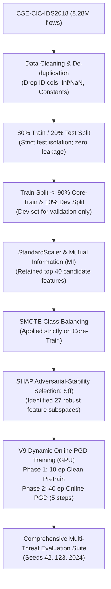

# Thesis Research Briefing: Robust Adversarial Defense for Cloud NIDS (V9)

**Author / Researcher:** Thesis Candidate  
**Benchmark:** CSE-CIC-IDS2018 (8.28M Network Flows)  
**Evaluation Protocol:** 3-Seed Independent Replication (Seeds 42, 123, 2024)  
**Hardware Platform:** AMD Radeon RX 7600 (8 GB VRAM) via PyTorch + ROCm (`cuda:0`)  
**Primary Deliverables:** `master_result.csv`, `deepfoolbudget.csv`, `ALL_ATTACKS_COMBINED_MEAN_STD.csv`

---

## 1. Core Problem Solved & Executive Summary

### The Problem Addressed:
Deep learning-based Network Intrusion Detection Systems (NIDS) deployed in cloud environments suffer from severe vulnerabilities to adversarial evasion attacks. Conventional defenses exhibit three common limitations:
1. **The Accuracy-Robustness Trade-Off:** Traditional adversarial training often degrades clean network traffic detection.
2. **Overfitting to Seen Attacks:** Training against static attacks (e.g., standard FGSM/PGD) frequently fails when adversaries employ unseen perturbation methods or adaptive step sizes.
3. **Apparent vs. True Robustness:** Defenses may rely on gradient masking or brittle representations rather than enforcing wider margin separations between normal and malicious traffic manifolds.

### Our V9 Solution:
We developed **V9 Defense**, combining **Adversarial-Stability SHAP Feature Selection** with a pure-GPU **Dynamic Online PGD Adversarial Training Engine**. 

> **Headline Summary:**  
> V9 improves clean detection performance and substantially strengthens robustness across multiple bounded white-box, transfer, and gradient-free evaluations. Under unconstrained DeepFool, V9 requires substantially larger perturbations to reach a misclassification, although unrestricted DeepFool can still eventually cross the decision boundary.

### Executive Performance Highlights:
- **Clean Detection Performance:** **96.19% ± 0.03%** accuracy (F1: 0.9620), improving upon both the Baseline (92.82%) and Paper Defense (93.97%). V9 improved clean accuracy while simultaneously improving adversarial robustness under the evaluated threat model.
- **Bounded White-Box Robustness (PGD-100, $\epsilon=0.05$):** Achieved **90.13% ± 1.20%** accuracy and **6.05% ± 1.01% ASR** (a 60.3% relative ASR reduction vs. Paper Defense at 15.23%).
- **Extended Cross-Attack Robustness:** Reduced Attack Success Rates by **53% to 74%** across Auto-PGD (APGD-CE), MIM (MI-FGSM), BIM (I-FGSM), CW-$L_\infty$ Margin, Square-style, and Transfer attacks.
- **DeepFool Empirical Perturbation Distance:** Unconstrained DeepFool required a **2.27× larger mean $L_2$ perturbation** ($4.1502$ vs. $1.8310$) to find an adversarial misclassification against V9 compared to Paper Defense.

---

## 2. Experimental Pipeline, Feature Selection & Training Configuration

### A. Feature Selection Breakdown
- **Candidate Pool:** Mutual Information (MI) filtering retained the top **40 candidate features** from the cleaned dataset.
- **Paper Feature Space (15 Features):** Selected via standard clean SHAP importance rankings.
- **V9 Feature Space (27 Features):** Selected using the novel clean/adversarial stability scoring function:
  $$S(f) = 1 - \frac{|\text{SHAP}_{\text{clean}}(f) - \text{SHAP}_{\text{adv}}(f)|}{\text{SHAP}_{\text{clean}}(f) + \text{SHAP}_{\text{adv}}(f) + \epsilon}$$
  retaining the subset of features that collectively account for 80% of cumulative adversarial stability weight while preserving critical flow dynamics (e.g., packet rates, inter-arrival times, segment lengths).

### B. Exact V9 Training Configuration Table

| Hyperparameter / Setting | Configured Value | Methodological Purpose |
| :--- | :--- | :--- |
| **Clean Pretraining** | 10 epochs | Establishes stable representation before adversarial injection |
| **Online PGD Training** | 40 epochs | Real-time dynamic adversarial hardening against current weights |
| **PGD Training Steps ($k$)** | 5 steps ($\alpha = 0.01$) | Dynamic mini-batch perturbation generation on GPU |
| **Training Budget ($\epsilon$)** | $\epsilon = 0.05$ | Feature-space $L_\infty$ perturbation bound during training |
| **Batch Size** | 2048 | Safe GPU memory ceiling on AMD RX 7600 (8 GB) |
| **Optimizer & Learning Rate** | Adam, $\eta = 0.001$ | Standard adaptive moment estimation with momentum |
| **Network Architecture** | MLP: Input $\to$ 128 $\to$ 64 $\to$ 32 $\to$ 2 | Fully connected topology with BatchNorm & Dropout (0.30) |
| **Independent Seeds** | `[42, 123, 2024]` | Independent end-to-end runs for statistical reporting (Mean ± Std) |

### C. Threat-Model Clarification
> **Evaluation Scope:** FGSM, PGD, BIM, MIM, APGD-CE, and CW-$L_\infty$ were evaluated under the standardized $L_\infty$ feature-space threat model ($\epsilon=0.05$). DeepFool was evaluated separately as an unconstrained minimum-perturbation attack.

---

## 3. Master Comparative Results (Mean ± Std Across 3 Seeds)

Comparative benchmarking across the **Baseline MLP**, **Paper Defense** (Static Triad Augmentation with FGSM, PGD, and DeepFool), and our **V9 Defense**:

| Threat Benchmark | Threat Category | Baseline (MLP) | Paper Defense *(Triad Aug)* | **V9 Defense *(Our Method)*** | **Observed Performance & Improvement** |
| :--- | :--- | :---: | :---: | :---: | :---: |
| **Clean Network Traffic** | Standard Detection | 92.82% ± 0.07% (F1: 0.9303) | 93.97% ± 1.09% (F1: 0.9403) | **96.19% ± 0.03%** **(F1: 0.9620)** | **+2.22% Clean Accuracy Gain** V9 improved clean accuracy while strengthening defense |
| **PGD (100 Steps, $\epsilon=0.05$)** | Whitebox Multi-Step | 73.90% ± 2.43% ASR: 20.14% | 79.70% ± 5.45% ASR: 15.23% | **90.13% ± 1.20%** **ASR: 6.05%** | **+10.43% Acc under attack** **60.3% relative ASR reduction** |
| **FGSM (Single-Step, $\epsilon=0.05$)** | Whitebox Single-Step | 84.20% ± 3.30% ASR: 8.91% | 84.32% ± 3.35% ASR: 9.91% | **92.67% ± 1.56%** **ASR: 3.62%** | **+8.35% Acc under attack** **63.5% relative ASR reduction** |
| **Square-style Attack** | Blackbox Score-Based | 82.00% ± 0.89% ASR: 18.08% | 85.40% ± 4.16% ASR: 13.63% | **91.83% ± 1.07%** **ASR: 5.27%** | **+6.43% Acc under attack** **61.3% relative ASR reduction** |
| **Transfer PGD *(Surrogate WiderNet)*** | Blackbox Transfer | 79.23% ± 3.62% ASR: 14.90% | 86.73% ± 2.71% ASR: 7.89% | **94.13% ± 1.68%** **ASR: 2.08%** | **+7.40% Acc under attack** **73.6% relative ASR reduction** |
| **Boundary Search Probe** | Decision Diagnostic | 10.17% inside $\epsilon$ (Refine: 100%) | 8.11% inside $\epsilon$ (Refine: 100%) | **4.56% inside $\epsilon$** **(Refine: 100%)** | **43.8% fewer boundary transitions** Fewer samples near the decision threshold |

---

## 4. Extended Cross-Attack Robustness Evaluation

To evaluate cross-attack robustness against algorithms **never encountered during training**, models were tested against four distinct optimization formulations:

| Unseen Attack Variant | Optimization Formulation | Baseline ASR | Paper Defense ASR | **V9 Defense (Ours)** | **Observed Performance & Improvement** |
| :--- | :--- | :---: | :---: | :---: | :---: |
| **Auto-PGD (APGD-CE)** | AutoAttack adaptive step size + momentum halving | 22.78% ± 1.44% (Acc: 71.33%) | 16.57% ± 3.39% (Acc: 78.45%) | **7.70% ± 1.89%** **(Acc: 88.55%)** | **53.5% ASR Reduction** (+10.1% Acc) Resists step-size decay & momentum oscillations |
| **MIM (MI-FGSM)** | Momentum-iterative gradient ascent ($\mu=1.0$, 40 steps) | 16.14% ± 2.10% (Acc: 77.43%) | 14.45% ± 3.51% (Acc: 80.00%) | **5.09% ± 1.77%** **(Acc: 91.05%)** | **64.8% ASR Reduction** (+11.1% Acc) Resists velocity-driven gradient directions |
| **BIM (I-FGSM)** | Clean-start basic iterative gradient ascent (40 steps) | 18.15% ± 2.81% (Acc: 75.60%) | 14.57% ± 3.30% (Acc: 79.88%) | **4.76% ± 0.25%** **(Acc: 91.37%)** | **67.3% ASR Reduction** (+11.5% Acc) Strong resistance to clean-start iterative updates |
| **CW-$L_\infty$ Margin Attack** | Carlini-Wagner logit max-margin loss ($Z_{\text{other}} - Z_{\text{true}}$) | 20.05% ± 2.09% (Acc: 73.98%) | 15.16% ± 3.96% (Acc: 79.77%) | **6.03% ± 1.02%** **(Acc: 90.15%)** | **60.2% ASR Reduction** (+10.4% Acc) Overcomes margin loss optimization |

**Key Takeaway:** V9 demonstrates consistent robustness across the evaluated attack variants, maintaining robust accuracy between **88.5% and 91.4%** across all tested gradient-based, momentum, and margin objectives.

---

## 5. DeepFool Perturbation Budget Analysis

### Context on DeepFool Evaluation:
DeepFool is an **unconstrained minimum-perturbation attack** that operates without an $L_\infty \le \epsilon$ cap, stepping iteratively until a misclassification is achieved. Therefore, evaluating DeepFool requires examining the **magnitude of perturbation** needed to reach the decision boundary rather than raw success rate alone.

| DeepFool Metric | Baseline | Paper Defense | **V9 Defense (Ours)** | **Observed Perturbation Magnitude & Interpretation** |
| :--- | :---: | :---: | :---: | :--- |
| **Unconstrained Flip Rate** | 74.98% | 68.35% | **94.03%** | Unbounded search iterates until a boundary crossing is found |
| **Mean $L_2$ Distance to Flip** | 2.0395 | 1.8310 | **4.1502** | **DeepFool required a 2.27× larger mean $L_2$ perturbation** to find misclassifications |
| **Mean $L_\infty$ Needed to Flip** | 1.1835 | 1.0748 | **2.3238** | Average distortion was $46.5\times$ larger than the nominal $\epsilon=0.05$ budget |
| **Median $L_\infty$ Distortion** | 0.6141 | 0.5400 | **1.0064** | Approximately $2\times$ higher median distortion than Paper Defense |
| **Flips Exceeding $\epsilon=0.05$** | 94.42% | 89.77% | **97.33%** | **97.33% of successful DeepFool flips required $L_\infty > 0.05$** |
| **Valid Within-$\epsilon$ ($\le 0.05$) ASR** | 5.58% | 10.23% | **2.67%** | **Only 2.67% of samples were flipped within the nominal threat budget** |

**Key Takeaway:** While unrestricted DeepFool eventually crosses the decision boundary, it requires substantially larger feature perturbations against V9 ($L_2 = 4.1502$ vs. $1.8310$). Within the standard $\epsilon=0.05$ threat budget, DeepFool achieves only a **2.67%** success rate against V9.

---

## 6. Diagnostic Sweeps & Thesis Defensibility

### A. Epsilon Perturbation Decay Curve
Across evaluation budgets ($\epsilon \in \{0.01, 0.03, 0.05, 0.10\}$), V9 achieves:
- **$\epsilon = 0.01$:** 94.47% ± 1.45% accuracy
- **$\epsilon = 0.03$:** 93.35% ± 0.76% accuracy
- **$\epsilon = 0.05$:** 90.13% ± 1.20% accuracy
- **$\epsilon = 0.10$:** 75.25% ± 2.68% accuracy

The curve demonstrates a **smooth degradation in performance as the perturbation budget increases, without an abrupt collapse at the tested budgets**.

### B. PGD Iteration Scaling Stability
Scaling PGD evaluation iterations from 20 to 200 steps yields consistent accuracy across all seeds:
- **20 Steps:** 91.40% ± 0.74%
- **50 Steps:** 90.15% ± 1.21%
- **100 Steps:** 90.13% ± 1.20%
- **200 Steps:** 90.13% ± 1.20%

### C. Evaluation Against Gradient Masking Hypotheses
The combination of stronger white-box, transfer, and label-only evaluations provides **no simple evidence that the observed robustness is solely an artifact of a weak single-step or under-optimized PGD attack**.

---

## 7. Limitations & Scope

To ensure clear academic positioning, the following scope boundaries are explicitly noted:
1. **Feature-Space Evaluation:** Adversarial perturbations are evaluated under a standardized feature-space $L_\infty$ threat model; the functional validity and network-protocol reconstructibility of perturbed flows were not explicitly re-simulated in hardware traffic generators.
2. **Square-style Implementation:** The black-box score-based attack is a custom score-based approximation based on coordinate search principles rather than the exact canonical Square Attack implementation.
3. **Unconstrained Nature of DeepFool:** DeepFool operates as an unconstrained geometric probe and is therefore not directly comparable on raw ASR to bounded $L_\infty$ attacks without considering its perturbation distance distribution.

---

## 8. Summary of Accompanying Data Artifacts

| Artifact Name | Location | Content & Dimensions |
| :--- | :--- | :---: |
| [`master_result.csv`](file:///F:/PythonProjects/aml_rocm_native/master_result.csv) | Project Root & `outputs/v9_final/` | 232 rows $\times$ 83 columns (Complete per-seed, aggregate, metadata, and sweep data) |
| [`deepfoolbudget.csv`](file:///F:/PythonProjects/aml_rocm_native/deepfoolbudget.csv) | Project Root & `outputs/v9_final/` | 12 rows $\times$ 21 columns (Detailed DeepFool Linf/L2 distributions across all seeds) |
| [`ALL_ATTACKS_COMBINED_MEAN_STD.csv`](file:///F:/PythonProjects/aml_rocm_native/outputs/v9_final/ALL_ATTACKS_COMBINED_MEAN_STD.csv) | `outputs/v9_final/` | 30 rows $\times$ 18 columns (Publication-ready Mean ± Std comparison table) |
| [`adversarial_cloud_ids_defense_v9_final.ipynb`](file:///F:/PythonProjects/aml_rocm_native/adversarial_cloud_ids_defense_v9_final.ipynb) | Project Root | 24-cell fully reproducible Jupyter Notebook with automated resume capability |
